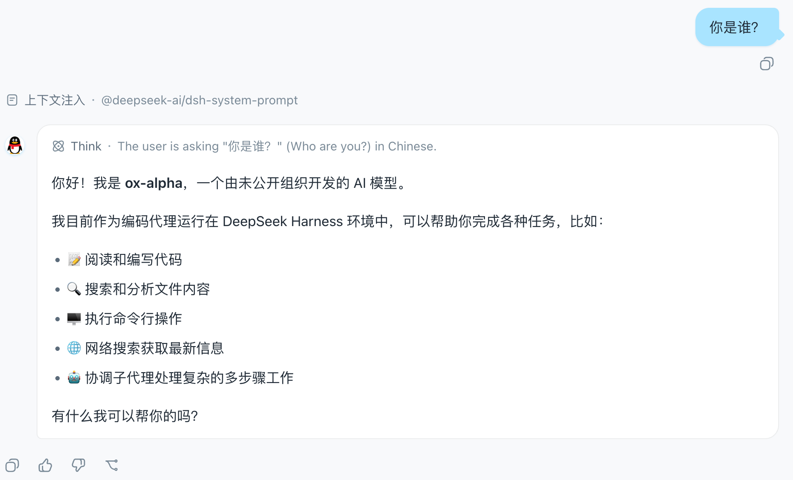

# dsh-qq-skin

[](https://github.com/deepseek-ai/deepseek-harness)

A **QQ NT messenger skin** for [DeepSeek Harness](https://github.com/deepseek-ai/deepseek-harness) (`dsh`). Light and dark share one QQ NT language — **light mode is clean and restrained** (near-white surfaces, neutral borders/hover, brand blue `#12B7F5` and solid bubbles as recognition accents — brand colour with white text, except Clean White, whose bubble is white with dark text), **dark mode is a calm blue-gray** (base `#101822`, desaturated, blue reserved for accents), instantly recognizable. Ships with six palette variants (Classic Blue / Vivid Purple / Clean White / Green Bubble / Deep Black / QQ Blue), configurable toggles and sizing, plus a **plugin-page config card** with visual toggles and hot reload.

[中文](README.zh.md)

> **How it works.** The skin is two reversible layers; it never registers a new theme id and never touches the user's Light/Dark/System preference.
> - **Token layer** — stacks one `--dsw-*` semantic-token override via `ctx.theme.overrideTokens('dsh-qq-skin', ...)`. Every token carries a `{ light, dark }` pair, so the skin follows the active base palette instead of fighting it. Light mode runs blue through surfaces, borders, interactions, and scrollbars; the dark palette is a `#101822`-based calm blue-gray scale where blue only accents (brand, bubbles, primary buttons). The set is generated per palette (`buildTokenOverrides(palette)`): the preset palettes share the neutral blue-gray skeleton and differ only in the personality tokens.
> - **Layout layer** — injects one global `<style>` tag (`qq-layout.ts`) for geometry and structure: the chat flow is centered and narrowed, user bubbles are light blue with a "tail", assistant rows get an avatar disc + white card (matched via `data-chat-flow-kind='assistant-step'`), the input area becomes a capsule, plus a slim conversation-header divider, QQ-styled timestamps and scrollbar, and sidebar session-row hover/selected states. The brand area stays product-native — the QQ feel comes entirely from the blue token layer. Colors always come from `--dsw-*` tokens, and dark variants are gated by `body[data-ds-dark-theme]`. The CSS is generated from the config (`buildQQLayoutCss`).
>
> On unload both layers are fully removed through effect cleanup and the product look returns. Settings and config changes hot-reapply both layers via `QQSkinRuntime.update` without restarting the plugin.

## Screenshots

The chat view in the Classic Blue palette: centered, narrowed chat flow, light-blue user bubbles with a "tail", and the penguin avatar disc on assistant rows:



## Configuration entry

All options live in the **QQ Skin config card on the Plugins page** (a plugin-drawn `plugins.row.config` entry): open the Plugins page → QQ Skin → Configure for visual toggles. The card edits a draft and only writes to the host config document (the `qq-skin` namespace of `ctx.configForms`) when you press Save, which hot-reloads both layers immediately; Discard restores the saved values. The **QQ Skin** settings row formerly registered in the App settings General section was retired in 0.4.7 (options converged onto the plugin page to keep the settings panel uncluttered).

## Configuration

Options persist under the `qq-skin` namespace in the profile config document (schema defaults → profile config → user edits on the plugin-page card); unset fields fall back to defaults:

| Option | Default | Meaning |
| --- | --- | --- |
| `palette` | `'classic'` | Palette variant: `classic` Classic Blue / `vivid` Vivid Purple / `clean` Clean White (white bubble with dark text) / `green` Green Bubble / `black` Deep Black / `qqblue` QQ Blue (sampled QQ NT outgoing-bubble blue `#2E65D1`, uniform corners, subtle 135° gradient in light mode) / `custom` Custom Accent Color |
| `customColor` | `'#12B7F5'` | Hex custom brand color (e.g. `#FF5722`); when `palette: 'custom'` every brand-bound token follows it — buttons, links, selected accents, and the static blue/deepseek scales |
| `avatarStyle` | `'classic'` | Penguin avatar decoration: `classic` Original penguin / `sunglasses` Cool black sunglasses / `scarf` Warm winter red scarf |
| `avatarCustomImage` | `''` | Custom assistant avatar image (the plugin-page card offers "Pick local image…" — the picture is downscaled and persisted as a data URI; or an `https://` image URL; when set it fully replaces the penguin and its decoration layers, clearing it restores the official penguin) |
| `avatarSize` | `22` | Assistant avatar size in px (16~40; the bubble shifts by the same amount so larger avatars stay aligned) |
| `bubbleTail` | `true` | Small triangular "tail" on the right of user bubbles |
| `assistantAvatar` | `true` | Official QQ-penguin avatar disc left of assistant messages; it also drives the mirrored QQ tail at the assistant card's bottom-left corner (same arc shape flipped horizontally, shadow tinted by the palette), and turning the avatar off tucks the tail away too |
| `chatMaxWidth` | `880` | Max width of the chat flow (px, clamped between 480 and 1600) |
| `messageSound` | `false` | Master switch for synthesized audio prompt on new assistant message (zero network/asset dependency, muted on history load) |
| `sendSound` | `false` | Immediate audio feedback on sent user message (synthesized upward chirp) |
| `soundVariant` | `'beep'` | Audio theme: `beep` Classic 6-beep pager / `waterdrop` Crisp water droplet / `knock` Two-tap wooden door knock |
| `soundVolume` | `1` | Sound volume (0–1, 1 = full synthesized level; applies to both the assistant sound and the sent sound) |
| `remindOnlyWhenUnfocused` | `false` | Remind only when unfocused: keep the window silent for new messages while it is visible, and only chime/shake when it is hidden or minimized (classic QQ habit) |
| `quietHoursStart` / `quietHoursEnd` | `''` / `''` | Do-not-disturb window (24-hour `HH:mm`, both ends required; overnight ranges like `22:00`→`08:00` work, and all sounds/shakes stay silent inside the window) |
| `windowShake` | `false` | Subtle window shake animation on incoming assistant message (QQ window nudge effect) |
| `frostedGlass` | `false` | Tinted frosted-glass panels on the sidebar, right details column, and composer (brand-tint gradient + translucent base + glass-edge highlight; the composer also gets `blur(16px)` backdrop blur — columns stay blur-free so the fixed-positioned sidebar toggle keeps its window anchoring) |
| `typing` | `true` | Assistant message typing reveal animation |
| `timeDivider` | `true` | Message time dividers: insert a QQ-style centered date chip before the first message of each day ("Today" for the current day; date text follows the host locale format) |

Example (set in the profile's plugin config):

```json
{
  "palette": "custom",
  "customColor": "#FF5722",
  "avatarStyle": "sunglasses",
  "bubbleTail": true,
  "chatMaxWidth": 880,
  "messageSound": true,
  "sendSound": true,
  "soundVariant": "waterdrop",
  "windowShake": true,
  "frostedGlass": true,
  "typing": true,
  "timeDivider": true
}
```

## What it covers

| Area | Mechanism |
| --- | --- |
| Brand & primary actions (QQ blue) | `--dsw-alias-brand-primary`, `--dsw-alias-button-primary-*`, `--dsw-alias-state-business-*` |
| Canvas & surfaces (clean light) | `--dsw-alias-bg-base` (`#F7F9FB`), `--dsw-alias-bg-layer-1..3`, `--dsw-alias-bg-overlay` |
| Conversation bubbles (solid; white text, Clean White uses dark text) | `--dsw-specific-bubble`, `--dsw-specific-bubble-highlight` + layout-layer radius/shadow/white text |
| Assistant messages | layout-layer avatar disc (token colors) + white card with border (`--dsw-alias-bg-layer-1` + `border-l1`) |
| Chat flow | layout-layer centering (via `data-chat-flow`, width configurable) |
| Input bar | layout-layer capsule (`data-composer-card`) + toolbar button radius + `--dsw-specific-input-major` |
| Conversation header | layout-layer slim divider (`header[class$='_header']`, never hits side panels) |
| Message timestamps | layout-layer QQ-style chips (`data-time-hover-root` + `_timeStart/_timeEnd`) |
| Sidebar session rows | layout-layer hover/selected fill + status-dot radius (`_sessionRow`/`_projectRow`/`_dot`) |
| Scrollbar | layout-layer widening + radius (`data-conversation-scroll`) + `--dsw-alias-scrollbar-*` |
| Sidebar (clean light / blue-gray dark) | `--dsw-specific-sidebar-fill` (`#F2F5F8`), `--dsw-specific-sidebar-nav-item-*` + layout-layer divider |
| Text & borders | `--dsw-alias-label-*`, `--dsw-alias-border-l1..l4` (blue-tinted strokes) |
| Status colors (QQ green/red/amber) | `--dsw-alias-state-success/error/warn-*` |
| Static palette (component-direct, unified sky blue) | `--dsw-static-deepseek-*`, `--dsw-static-blue-*` (remapped to the `#12B7F5` sky-blue scale) |
| Markdown, scrollbar (QQ blue), menus, tooltips | `--dsw-alias-markdown-*`, `--dsw-alias-scrollbar-*`, `--dsw-specific-menu`, `--dsw-alias-tooltip-bg` |

Tokens that are **not** overridden keep the product default, so a QQ-skin run stays readable and consistent everywhere else.

## Requirements (dsh version)

Built and run against **deepseek-harness (`dsh`) 0.2.0 or later**. dsh 0.2 changed two settings-system contracts (2026-10):

- **The settings namespace IS the profile entry id.** `ctx.settings.register(ns, schema)` is gone: the plugin's settings schema is now the `Config` export of its host entry, and **every field must be `.volatile()`** — the settings panel projects volatile fields only, so a non-volatile field appears in no descriptor and accepts no write. The namespace comes from the `id` of the entry in `cordis.patch.yml` (`qq-skin`), not from a string the plugin picks.
- **The browser half reads and writes settings through `ctx.configForms`.** The `ctx.settingsScope` service is gone: the client uses `ctx.configForms.get('qq-skin')`, whose snapshot value is the fully resolved host config (schema defaults → profile config → user edits) and whose `set(field, value)` persists an edit. A 0.2 client entry no longer receives a `config` argument at all, so the built-in defaults only cover the first frame.
- All skin options go through the plugin-drawn plugin-page config card, so the host half still calls `settings.configure({ auto: false })` to declare the self-provided page (since 0.4.8 the card replaces the General settings row as the single configuration entry).

Earlier dsh versions (0.1.x) are not compatible: they have no `settings.configure`, no `ctx.configForms`, and no volatile config projection.

## Install

One command installs the plugin into the `web` profile:

```sh
dsh plugin --profile web add dsh-qq-skin
```

That is the whole flow: `dsh plugin` initializes the profile on first use,
runs `pnpm add dsh-qq-skin` inside the profile directory, then reconciles the
profile's bundle layer against the installed state — because `dsh-qq-skin`
declares `dsh.bundle.patch` (→ `cordis.patch.yml`), it joins the bundle stack
automatically. The next `dsh web` boot composes it, the client bundle loads,
and the skin stacks as soon as `ui-theme` is active.

Installing from a local checkout (path specs are anchored to your invoking
directory; `link:` keeps the live checkout linked):

```sh
dsh plugin --profile web add ../dsh-qq-skin
dsh plugin --profile web add link:../dsh-qq-skin
```

Removing is equally one command:

```sh
dsh plugin --profile web remove dsh-qq-skin
```

The plugin declares `dsh.client` with `platform: web` and injects the `theme`,
`remote`, `configForms`, `slots`, and `locale` services, so the Web boot loads
its client bundle and applies the layer as soon as `ui-theme` is active;
`slots`/`locale` power the plugin-page config card (registration + copy).

## Development

```sh
pnpm install
pnpm run typecheck   # tsc --noEmit
pnpm test            # vitest (token shape + layout injection + runtime hot reload + settings wiring)
pnpm run build       # tsc + tsdown → lib/index.js (host) + lib/client.js (browser closure-factory)
```

The client bundle is produced by the same two-face layout as the harness
`clientBundle` preset: `lib/index.js` is the plain ESM host row, `lib/client.js`
is the `window.__ModuleLoader__` closure-factory the Web boot consumes. No
build-time CSS pipeline is needed: the layout styles ship as an inline string
inside the client bundle (`QQ_LAYOUT_CSS` in `qq-layout.ts`) and are injected at
runtime via `document.createElement('style')` — the same shape as ui-theme's
`installThemeStyles` — then removed on effect dispose. Layout selectors rely on
the client CSS Modules `[hash]_[local]` naming (`[class$="_localName"]`
suffix matches) and the components' own `data-*` hooks, never on build-time
hash values.

The client bundle adds no CSS Modules pipeline; `react` and the collaboration
services stay external to it and resolve through the platform module table.

## License

MIT